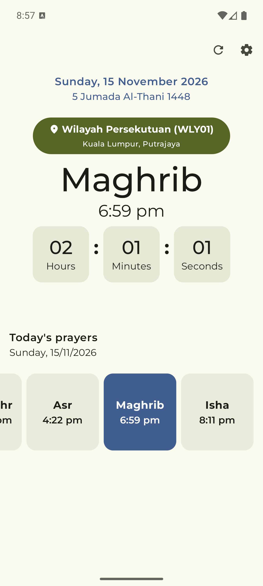
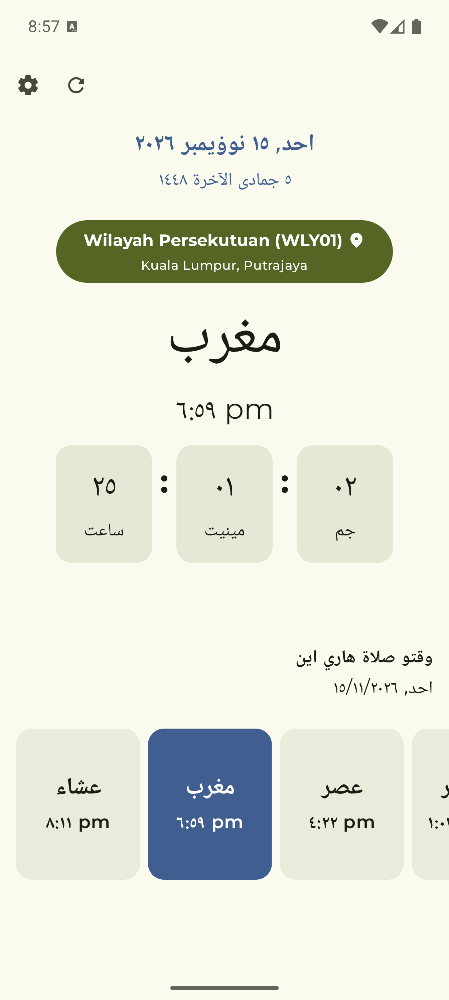
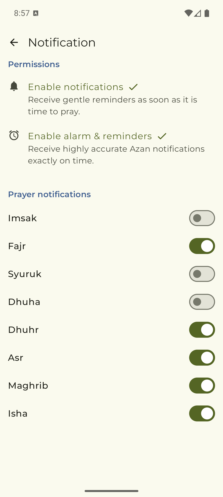
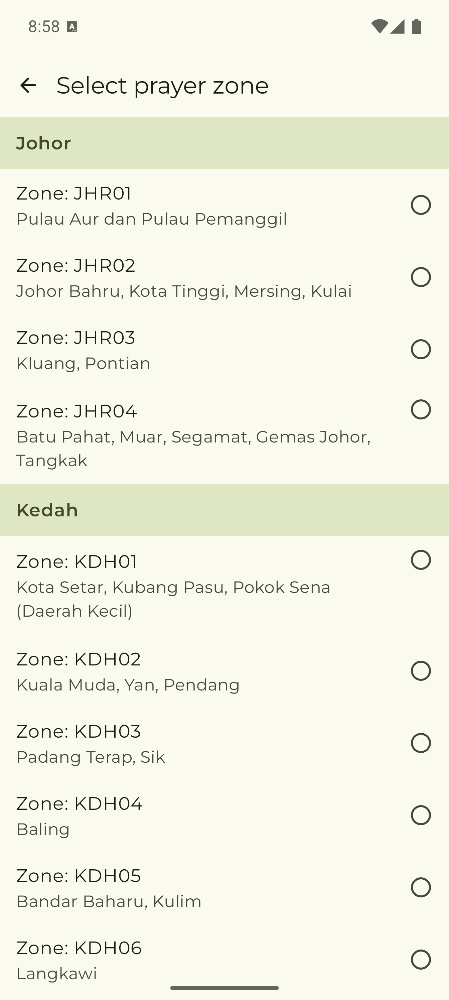

# Solat

[](#how-solat-is-made)

## Overview

**Solat** is an Android application developed to display and notify Muslim prayer time.
This app fetch data from [Waktu Solat API](https://api.waktusolat.app/) that provides accurate prayer times for all locations in Malaysia, based on data from [JAKIM](https://www.e-solat.gov.my/).

> **Status:** version 1.1.0 is in development. See the [roadmap](docs/ROADMAP.md) and the [release notes](docs/releases/1.1.0.md).

## Features

- Display prayers times (5 prayer times a day)
- Prayer countdown from one to another
- Choose your prayer zone from the list of JAKIM zones, once, during setup (it can be changed in Settings)
- A notification at each prayer time, which can be switched on or off for each prayer
- English, Malay and Jawi, with a light, dark or system theme
- Prayer times are saved on the phone, so they still show without an internet connection, and the refresh button downloads them again
- (TODO) Determine the Qibla direction (Utitilize Android's SensorManager)

## Demo

<p>
  
  
  
  
</p>

Today's prayer times and the countdown to the next one, the same screen in Jawi, the notification settings, and choosing a zone.

## Installation

Download the APK from the [`Releases`](https://github.com/rafeeqy/solat/releases) section. If installing APK directly, enable installation from unknown sources in device settings.

Requires Android 10 (API 29) or newer.

## Building

```bash
./gradlew assembleDebug
```

The build needs JDK 17 or newer (Android Studio's bundled JDK works) and an Android SDK with API 36.

Tests:
```bash
./gradlew testDebugUnitTest
```
They run on the JVM with Robolectric, so no phone or emulator is needed.

## How Solat is made

Solat is vibe coded from version 1.1.0 on. The code, tests and docs added since then have been written by Claude, Anthropic's AI model, working in [Claude Code](https://claude.com/claude-code). Before that, the project owner wrote the app by hand, up to and including the 1.0.1 release.

- **The project owner** acts as product manager: they decide what the app should do, make the calls recorded as decisions in the [roadmap](docs/ROADMAP.md), and review and try out each phase before it's merged.
- **Claude** acts as the engineer: it plans each phase, writes the code and tests, builds the app and checks it on an emulator, and prepares one branch per phase. A branch is merged into the version branch only after the owner has reviewed it.

Every commit Claude writes ends with a `Co-Authored-By: Claude` line, so `git log` shows which work is Claude's.

## License

[Apache License 2.0](https://github.com/rafeeqy/solat/blob/main/LICENSE)
